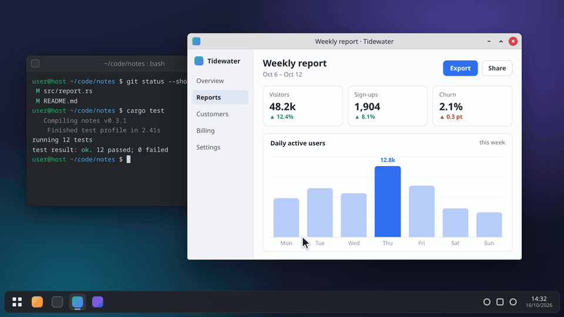
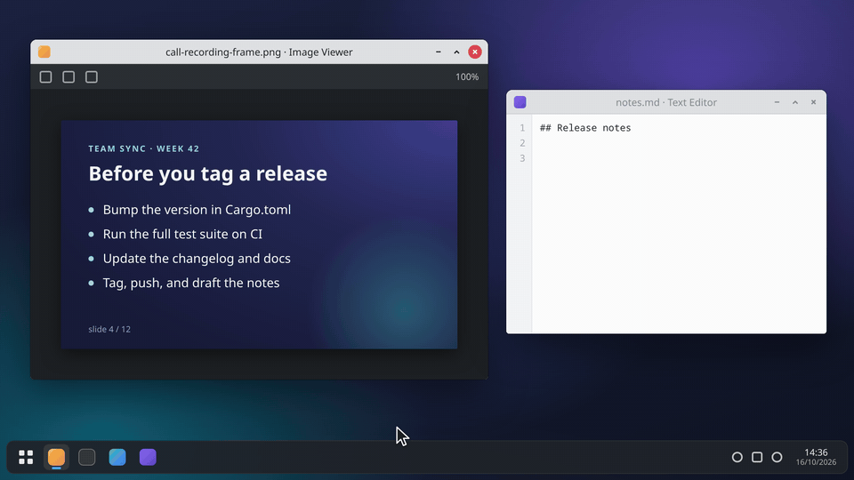

<div align="center">


# snip

**Fast region screenshots with quick annotations and OCR, for KDE Plasma on Wayland.**

[](LICENSE)
[](https://www.rust-lang.org/)
[](https://kde.org/plasma-desktop/)



</div>

## Why

On Linux, the tool I missed most was [ShareX](https://getsharex.com/): one hotkey, pick a region, add a number or an arrow, and it's on the clipboard. snip started as a small personal tool to get that back on KDE Plasma. It ended up very fast and covers my use cases, so I'm sharing it in case it's useful to someone else.

## Features

| | |
|---|---|
| **Click to snap** | Hover highlights the window under the cursor. Click to take that window, click the desktop to take the whole monitor, or drag to select any region. |
| **Annotate before copying** | Press `1`, `2` or `3` before you release the selection to add numbered markers, arrows or freehand drawing. |
| **OCR to clipboard** | Select a region and the recognised text (tesseract) goes to the clipboard. Light-on-dark text works too. |
| **Clipboard first** | The result lands on the Wayland clipboard as PNG (or text). `Ctrl+S` also saves a file. |
| **Multi-monitor, HiDPI** | The screen is frozen and shown as an overlay on every output. Fractional scaling is handled and annotations are drawn at full resolution. |
| **Global hotkeys** | Bound through KDE's kglobalaccel, either at install time or in a small settings app. Nothing has to stay running. |

<div align="center">

</div>

## Install

**Requires KDE Plasma 6 on Wayland.** snip relies on `spectacle`, KWin scripting and kglobalaccel, so it does not work on other desktops or on X11.

You need spectacle, tesseract with English data, notify-send, fontconfig, and Python GTK 4 + libadwaita bindings.

<details>
<summary>Package names for Arch, Debian/Ubuntu and Fedora</summary>

| Need | Arch | Debian / Ubuntu | Fedora |
|---|---|---|---|
| spectacle | `spectacle` | `kde-spectacle` | `spectacle` |
| tesseract + English data | `tesseract tesseract-data-eng` | `tesseract-ocr tesseract-ocr-eng` | `tesseract tesseract-langpack-eng` |
| notify-send | `libnotify` | `libnotify-bin` | `libnotify` |
| fc-match | `fontconfig` | `fontconfig` | `fontconfig` |
| Python GTK 4 + libadwaita (for `snip-settings` and hotkey binding) | `python-gobject gtk4 libadwaita` | `python3-gi gir1.2-gtk-4.0 gir1.2-adw-1` | `python3-gobject gtk4 libadwaita` |

Building from source also needs Rust ≥ 1.88 (`rust` / `cargo` / `cargo`). `install.sh` checks for everything and lists anything missing before it installs.

</details>

Prebuilt binary (x86_64, glibc 2.34+; no Rust needed):

```sh
curl -fsSL https://github.com/boisenme/snip/releases/latest/download/snip-x86_64-linux.tar.gz | tar xz
cd snip && ./install.sh Meta+Shift+X Meta+Shift+T  # hotkeys are optional: screenshot, OCR
```

Or build from source:

```sh
git clone https://github.com/boisenme/snip.git && cd snip
./install.sh                            # build and install into ~/.local
./install.sh Meta+Shift+X Meta+Shift+T  # also bind hotkeys: screenshot, OCR
```

This installs `~/.local/bin/snip`, `~/.local/bin/snip-settings` and three `.desktop` files in `~/.local/share/applications`. Make sure `~/.local/bin` is on your `PATH`.

## Usage

Press your screenshot hotkey (or run `snip`), then:

| Action | |
|---|---|
| Click a window / the desktop | copy that window / the whole monitor |
| Drag | copy a region |
| `1` / `2` / `3` before releasing | annotate first: numbered markers / arrow / freehand draw |
| `1` / `2` / `3` while annotating | switch tool (each marker click adds the next number) |
| `Ctrl+Z` | undo the last annotation |
| `Enter` or `Ctrl+C` | copy the annotated image |
| `Ctrl+S` | save and copy |
| `Esc` or right-click | cancel (right-click only before annotating) |

The OCR hotkey (or `snip ocr`) works the same way, minus the annotations: the text in the selection is copied, and a notification shows a preview.

`Ctrl+S` saves to `$(xdg-user-dir PICTURES)/Screenshots/snip_YYYY-MM-DD_HH-MM-SS.png` (fallback `~/Pictures/Screenshots`) and also copies the image.

```
snip [shot]   select a region or window, optionally annotate, copy as PNG (default)
snip ocr      select a region or window, copy its text
snip windows  diagnostic: print the window rectangles click-to-snap would offer
```

### Hotkeys

Run `snip-settings` to change the hotkeys at any time. It records a key combination and stores it in kglobalaccel, so the hotkeys work without the app running. It can also switch your keyboard layout to its "no dead keys" variant, so keys like `´` or `¨` can be used as hotkeys.

## Configuration

OCR is configured with environment variables:

| Variable | Default | Meaning |
|---|---|---|
| `SNIP_OCR_LANG` | `eng` | tesseract language(s), e.g. `eng+deu` (install the matching traineddata) |
| `SNIP_OCR_PSM` | `6` | tesseract page segmentation mode |
| `SNIP_OCR_CMD` | unset | replaces tesseract entirely: a shell command that reads a PNG on stdin and writes text to stdout |

## Uninstall

```sh
./uninstall.sh
```

This removes the hotkeys and every file `install.sh` installed.

<details>
<summary><b>How it works</b></summary>

The screen is captured with `spectacle -b` and shown frozen in wlr-layer-shell overlays, one per output, with the unselected area dimmed. To find window outlines for click-to-snap, snip loads a temporary KWin script that sends the window geometry back over D-Bus. If KWin scripting is unavailable, clicks fall back to whole outputs.

For OCR the selection is converted to greyscale, inverted if the text is light on dark, upscaled, and passed to tesseract. After copying, snip detaches from the hotkey daemon and keeps serving the clipboard until something else is copied.

</details>

## Inspiration

snip exists because of [ShareX](https://getsharex.com/), the excellent open-source screenshot tool for Windows. It's not affiliated with ShareX and does a small fraction of what ShareX can do.

## License

[MIT](LICENSE)

## Check out everdir

If you miss Everything or WinDirStat on Linux, have a look at [**everdir**](https://github.com/boisenme/everdir), my instant whole-disk file search with a disk-usage treemap.
